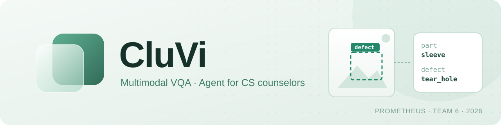
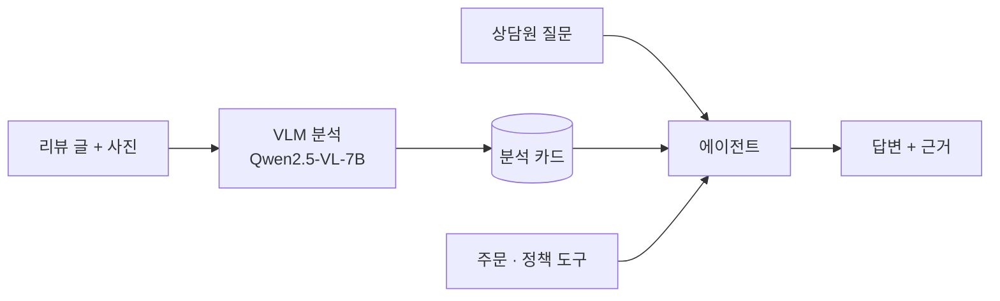

<picture>
  <source media="(prefers-color-scheme: dark)" srcset="https://raw.githubusercontent.com/CluVi-prometheus/.github/main/profile/assets/banner-dark.svg">
  
</picture>

### 사진 민원을 읽고 CS 상담원을 돕는 멀티모달 VQA · 에이전트

고객이 올린 리뷰 글과 사진에서 **무슨 결함인지 · 어느 부위인지 · 사진 어디에 보이는지**를 분석 카드로 만들고, 
상담원이 물으면 에이전트가 그 카드와 주문 · 정책 조회를 근거로 답합니다.

**[메인 레포 `cluvi` 바로 가기 →](https://github.com/CluVi-prometheus/cluvi)**

 

## 흐름

연구 목표는 정확도를 지키면서 VLM 추론 비용(시각 토큰 · 지연 · 메모리)을 줄이는 것입니다.

## 레포

| 레포 | 하는 일 |
|---|---|
| **[cluvi](https://github.com/CluVi-prometheus/cluvi)** | 메인 레포. 팀이 맞춘 것 · 결과 비교 · 서비스 · 상담원 화면 |
| [jimni3155](https://github.com/CluVi-prometheus/jimni3155) | 개인 실험 레포 |
| [joungjubinn](https://github.com/CluVi-prometheus/joungjubinn) | 개인 실험 레포 |
| [vmgfh878-art](https://github.com/CluVi-prometheus/vmgfh878-art) | 개인 실험 레포 · Heavy 경로 (제로샷 · HAWK · LoRA) |

## 일정

베이스라인 `10/27–11/13` → 토큰 선택 실험 `~12/8` → 에이전트 · API `~1/8` → 데모 통합 · 평가 `~1/22` → 최종 제출 `1/30`

진행 상황은 [마일스톤](https://github.com/CluVi-prometheus/cluvi/milestones)에서 봅니다.

## 팀

<table>
  <tr>
    <td align="center"><a href="https://github.com/jimni3155"> <b>jimni3155</b></a></td>
    <td align="center"><a href="https://github.com/joungjubinn"> <b>joungjubinn</b></a></td>
    <td align="center"><a href="https://github.com/vmgfh878-art"> <b>vmgfh878-art</b></a></td>
  </tr>
</table>

프로메테우스 6팀 · 2026 &nbsp;|&nbsp; 데이터셋에는 고객 사진이 들어 있어 공개하지 않습니다.
